# Hector SLAM on the TurtleBot 4: metrics report

ICTE4001 case study, "Application Results and Performance Evaluation". All runs on 2026-10-24.
This report collects every measurement behind that section: what was tested, how it was
measured, the numbers, and what they mean. The figures are in [`figures/`](figures/), the
raw data of each run in [`webots/`](webots/) and [`real_robot/`](real_robot/), and the
scripts that produced all of it in [`scripts/`](scripts/) (see section 12).

## 1. Summary

| What | Result | Section |
| --- | --- | --- |
| Map quality, Webots, Hector only (W1) | wall precision **99.0 %**, recall **100 %**, free coverage **97.6 %**, mean wall error **2.5 cm** | 4 |
| Map quality, all Webots mapping runs (A–E, W1, W5) | precision 98.1–99.1 %, recall 96.2–100 %, coverage 94.2–97.6 % | 4, 6 |
| Hector localisation, Webots (W1) | **0.7 cm** RMSE when the robot is stopped; 3.3 cm RMSE while driving at 0.25 m/s, mostly logging latency (4.3) | 4 |
| Nav2 on the saved map (W2) | 3 of 6 goals SUCCEEDED; 1 more reached (21 cm) but not declared done; 2 stalled ("Failed to make progress") | 5 |
| AMCL accuracy at the goals | **2.1 cm mean, 3.9 cm max** over 6 stops | 5 |
| Kidnapped robot, AMCL (W3) | lost by 6.8 m, AMCL alone never recovers; **global relocalisation converges in 6 s to 4 cm**; manual pose: 1 cm | 7.1 |
| Kidnapped robot, Hector, 2.05 m / 91° (W4) | **never recovers**: map destroyed (precision 25 %), pose error 6 m to the end | 7.3 |
| Kidnapped robot, Hector, 0.22 m / 10° (W5) | recovers within 1 s, map unaffected (precision 99.1 %) | 7.3 |
| Fast turns, 3× patrol speed, 82–103°/s (W6) | Hector loses track at t = 58 s, map destroyed (precision 17.8 %) | 8 |
| Real TurtleBot 4, live Hector run | one room mapped cleanly for ~70 s, then two heading slips (~10° and ~110°) duplicated the room | 9 |
| Real robot bag replayed with a wheel-odometry prior | final heading error **0.5°** instead of 88–131°; one clean room, 4.20 m × 6.19 m | 9.4 |
| Processing rate | Hector processes every scan: 8.9 Hz in Webots, 7.3 Hz on the real RPLIDAR | 10 |

## 2. Setup

### 2.1 Simulation (Webots)

| | |
| --- | --- |
| Simulator | Webots R2025a (snap), on the host; ROS 2 Jazzy (Ubuntu 24.04) in a Docker container, host networking |
| Computer | Intel i7-13620H, 16 threads, no GPU (Webots and RViz render with Mesa llvmpipe on a private Xvfb display) |
| World | `turtlebot_hector_slam/webots/worlds/hector_slam_test.wbt`: 10 m × 8 m, 4 rooms, 8 walls, 5 box obstacles, 0.5 m high walls ([fig. 1](figures/fig01_webots_world_and_rviz.png)) |
| Robot | TurtleBot 4 proto, differential drive, wheel odometry from the wheel encoders |
| Lidar | 360 beams, 0.164–12 m, 10 Hz (like the RPLIDAR A1), mounted yawed 90° like the real robot |
| Ground truth | the bridge publishes `/ground_truth/pose` (Webots GPS + IMU) relative to the start pose, i.e. in Hector's `map` frame; `webots/maps/ground_truth.pgm` is the true occupancy grid |
| Patrol | for repeatable mapping runs the bridge drives a fixed 29-waypoint loop through every room and back to the start (0.25 m/s, turns up to 0.6 rad/s) |
| Kidnap | `/kidnap` (Pose2D): the bridge (a Webots supervisor) teleports the robot; the wheels don't turn, so odometry doesn't see the jump |
| Real-time factor | 0.8–1.0× with Hector only, 0.3–0.5× with Nav2 + RViz + screen recording. All timing in this report is sim time |

### 2.2 Software

| Component | Version / setting |
| --- | --- |
| Hector SLAM | `hector_mapping` from the ROS 2 port, with our fixes (`turtlebot_hector_slam/docs/hector_ros2_port_fixes.md`) |
| Hector parameters | `tb4_hector_slam/config/hector_slam.yaml`: 0.05 m cells, 512 × 512 map, 2 resolution levels, `update_factor_free` 0.4, `update_factor_occupied` 0.9, map update every 0.4 m / 0.06 rad, laser 0.15–12 m, no odometry prior unless stated |
| Nav2 | 1.3.13 (Jazzy). NavFn planner, DWB controller (max 0.15 m/s, 0.6 rad/s), goal tolerance 0.25 m / 0.25 rad, inflation 0.45 m, robot radius 0.175 m |
| AMCL | differential motion model, alpha1–5 = 0.2, likelihood-field model, 60 beams, 500–2000 particles, update every 0.1 m / 0.1 rad, `recovery_alpha_slow/fast` = 0 (no random particles) unless stated |
| Two-phase workflow | phase 1 `hector_slam_launch.py` (Hector + trajectory server); save with `map_saver_cli`; phase 2 `nav_on_map_launch.py` (map_server + AMCL + Nav2). Hector and AMCL never run at the same time |

### 2.3 Real robot

TurtleBot 4 (Create 3 base, RPLIDAR A1), Jazzy, laptop running the dashboard over Wi-Fi,
session `20261024_165705`. Hector only (phase 1), driven by hand from the dashboard. The
session's files are in [`../real_robot/`](../real_robot/): a 198 s rosbag (`/scan`, `/odom`,
`/tf`, `/tf_static`, `/map`), the dashboard's trajectory log, logs, a screen video.

## 3. Metrics

Map metrics come from `webots/tools/evaluate_map.py`, which moves each occupied cell of the
saved Hector map into the world frame and compares it with the ground-truth grid
(tolerance 0.10 m). Pose metrics compare Hector's `map → base_link` (or AMCL's, in phase 2)
with `/ground_truth/pose`, logged at 1–2 Hz of sim time.

| Metric | Definition | What it shows |
| --- | --- | --- |
| Wall precision | % of occupied SLAM cells within 0.10 m of a true wall or obstacle | phantom, doubled or smeared walls |
| Wall recall | % of true wall cells (visible from inside the room) within 0.10 m of an occupied SLAM cell | missing walls |
| Free coverage | % of true free cells that the SLAM map marks free | how complete the map is |
| Mean wall error | mean distance from each occupied SLAM cell to the nearest true obstacle | geometric accuracy |
| Position error, RMSE / max | Euclidean distance between the estimated and the true pose | localisation accuracy |
| Heading error, mean / max | absolute yaw difference | localisation accuracy |
| AMCL error at a goal | distance between AMCL's estimate (TF `map → base_link`) and the true pose 2 s after Nav2 reports the goal | localisation accuracy in phase 2 |
| Distance to goal | true stop position to the goal | Nav2 accuracy; includes the 0.25 m goal tolerance |
| Particle spread | RMS distance of the AMCL particles to their mean | how certain AMCL is |
| Recovery time | sim time from the start of a recovery until AMCL error < 0.25 m and spread < 0.25 m | kidnapped-robot recovery |
| Heading offset (real robot) | Hector yaw − Create 3 odometry yaw, relative to its start value | scan-matching slips (no ground truth on the robot) |

## 4. Phase 1 in Webots: Hector mapping (W1)

Hector only, patrol loop, 304 s of sim time, 368 s wall. Data: [`webots/W1_mapping/`](webots/W1_mapping/).

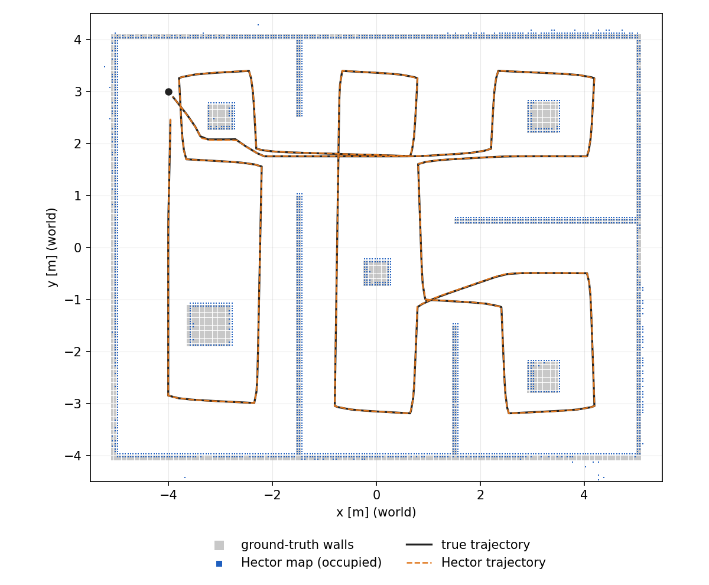

*Fig. 2: W1. Hector's occupied cells (blue) on the true walls (grey), true trajectory (black) and Hector's trajectory (orange, dashed).*

| Metric | W1 |
| --- | --- |
| Wall precision | 99.0 % |
| Wall recall | 100.0 % |
| Free coverage | 97.6 % |
| Mean wall error | 2.5 cm |
| Position error (all samples) | mean 3.1 cm, RMSE 3.3 cm, max 5.1 cm |
| Position error, robot stopped (31 samples) | RMSE 0.7 cm, mean 0.5 cm |
| Heading error | mean 1.25°, max 4.98° |
| Scans received / processed | 2722 / 2722 (8.9 Hz each) |

### 4.1 Map

The map has every wall and all five obstacles. The 1 % of occupied cells that miss
the ground truth are single cells at wall ends and corners, where rays graze a wall at a
shallow angle. Coverage stays below 100 % because the 2.4 % unknown cells are directly behind
obstacles and in narrow gaps that the patrol never sees.

### 4.2 Mapping over time

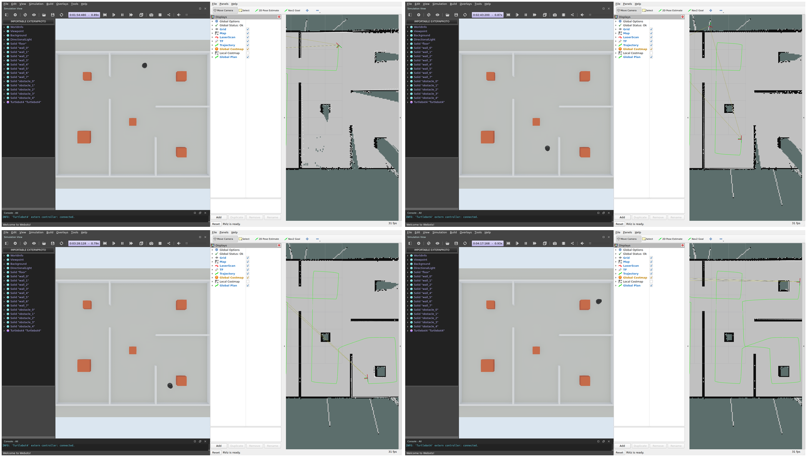

*Fig. 3: W1, Webots (left) and RViz (right) at four points during the patrol. RViz shows the Hector map, the live scan and the trajectory (`/trajectory` from hector_trajectory_server).*

### 4.3 Pose error

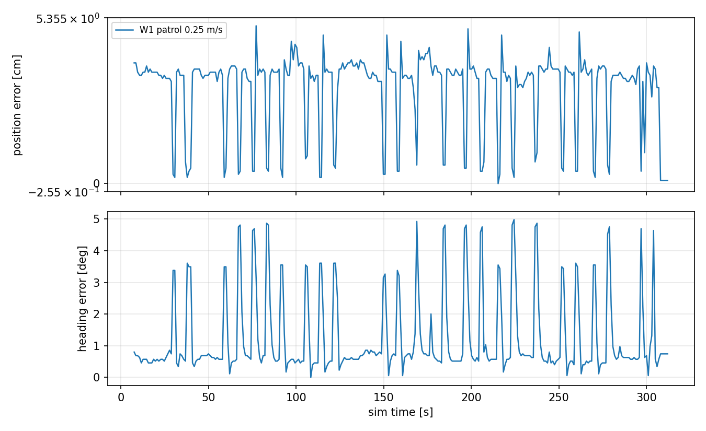

*Fig. 5: W1, Hector's position and heading error against ground truth.*

The error is almost constant while the robot drives and drops to below 1 cm whenever it stops
to turn. The error points along the direction of travel. That is a latency, not drift:
Hector's TF is stamped with the scan time and is about 0.13 s old when the logger reads it, and
0.13 s at 0.25 m/s is the 3 cm seen here. The earlier full-exploration runs (B–D), which drove
at Nav2's 0.15 m/s, gave 1.0–1.4 cm RMSE for the same reason. The stopped-robot figure, 0.7 cm,
is the real accuracy of the scan matcher here. There is no growing drift over the 5 minutes
even though Hector has no loop closure, because the room never leaves the 12 m lidar range
and every scan is matched against the same, already-correct map.

### 4.4 Comparison with the earlier Webots runs

| Run | Setup | Precision | Recall | Coverage | Wall err | Pose RMSE (max) |
| --- | --- | --- | --- | --- | --- | --- |
| A, 2026-10-22 | Hector + Nav2 + explorer (baseline) | 98.3 % | 96.2 % | 94.2 % | 3.0 cm | 1.2 cm (6.6) |
| B, 2026-10-24 | Hector + Nav2 + explorer | 98.1 % | 99.0 % | 97.3 % | 3.1 cm | 1.0 cm (4.3) |
| C | as B, robot clock 5 s behind | 98.5 % | 98.2 % | 97.1 % | 2.7 cm | 1.1 cm (4.5) |
| D | as B, dashboard "real robot" mode | 98.3 % | 97.7 % | 96.6 % | 2.7 cm | 1.4 cm (2.6) |
| E | two-phase, phase 1 (patrol) | 98.9 % | 100.0 % | 97.6 % | 2.6 cm | – |
| **W1** | two-phase, phase 1 (patrol) | **99.0 %** | **100.0 %** | **97.6 %** | **2.5 cm** | 3.3 cm (5.1), 0.7 cm stopped |
| W5 | as W1 + 0.22 m kidnap | 99.1 % | 100.0 % | 97.6 % | 2.5 cm | 3.6 cm (24.5) |

A–E are in `turtlebot_hector_slam/webots/results/` and `/metrics.md`. Seven runs with two
different drivers (Nav2 explorer, patrol) all land at 98–99 % precision and 2.5–3.1 cm mean
wall error: the result is repeatable.

## 5. Phase 2 in Webots: Nav2 + AMCL on the saved map (W2)

The W1 map loaded by map_server; AMCL starts at (0, 0, 0), where mapping started. Six goals
sent one after another with `NavigateToPose`, covering every room, two of them behind a
dividing wall so the planner has to route through a doorway. Data: [`webots/W2_nav_goals/`](webots/W2_nav_goals/).

| # | Goal (map) | Result | Time [s] | Stopped at (ground truth) | AMCL estimate | AMCL error [cm] | Heading error [deg] | Distance to goal [cm] |
| --- | --- | --- | --- | --- | --- | --- | --- | --- |
| 1 | (1.80, -1.30) | SUCCEEDED | 19 | (1.582, -1.365) | (1.574, -1.332) | 3.4 | 0.7 | 23 |
| 2 | (0.00, -6.00) | SUCCEEDED | 40 | (-0.139, -5.803) | (-0.121, -5.809) | 1.9 | 2.4 | 24 |
| 3 | (4.80, -5.50) | TIMEOUT | 151 | (1.829, -2.008) | (1.791, -2.003) | 3.8 | 1.5 | 459 |
| 4 | (8.20, -6.20) | TIMEOUT | 151 | (8.094, -6.014) | (8.094, -6.007) | 0.6 | 1.3 | 21 |
| 5 | (8.20, 0.40) | TIMEOUT | 151 | (6.629, 0.187) | (6.642, 0.168) | 2.4 | 2.1 | 159 |
| 6 | (0.00, 0.00) | SUCCEEDED | 80 | (0.180, 0.117) | (0.175, 0.118) | 0.6 | 1.7 | 21 |

Timeout 150 s of sim time per goal. Time is sim time.

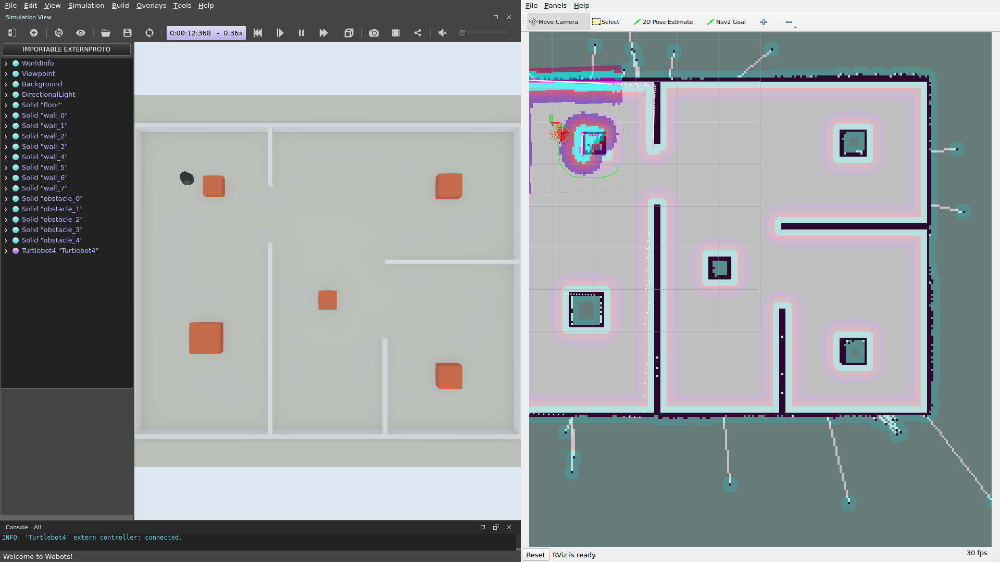

*Fig. 9: Nav2 driving to a goal on the saved W1 map (from W3, before the kidnap; in the W2 rerun the RViz window was not placed, so its screenshots and video show RViz small in a corner). RViz: saved Hector map, global costmap (inflation), local costmap, global plan (green), AMCL particles (red), live scan.*

- **Localisation is accurate at every stop:** AMCL error 2.1 cm on average and 3.9 cm at most,
  heading error 0.7–2.4°. That includes the three goals Nav2 did not finish, so AMCL
  tracked the robot correctly the whole time, over ~25 m of driving. Run E gave
  1.4–3.2 cm with three goals.
- **Distance to goal is ~21–24 cm** for the successful goals. That is the controller's
  0.25 m `xy_goal_tolerance`, not a localisation error.
- **Nav2 completed 3 of 6 goals.** The failures are all the controller
  ("Failed to make progress", 28 times in the log), not the planner:
  - Goal 3 (4.8, −5.5) needs the doorway in the left room's divider (1.5 m wide). With
    0.45 m inflation on both sides plus the 0.175 m robot radius, only ~0.25 m of the doorway is
    low-cost. DWB oscillated in front of it until the timeout.
  - Goal 4 (8.2, −6.2): the robot got within 21 cm, inside the position tolerance, in the
    corner of the bottom-right room. It could not finish turning to the goal heading next to the
    wall, so Nav2 never reported success.
  - Goal 5 (8.2, 0.4) stalled 1.6 m short, in the passage around an obstacle.
  - This matches the explorer runs (section 6): this DWB setup (max 0.15 m/s, inflation 0.45 m)
    struggles in tight spaces. Smaller inflation, a lower `cost_scaling_factor`, or the
    Regulated Pure Pursuit / MPPI controller would be the next things to try. This is a tuning
    issue of the navigation stack and does not affect the SLAM results.
- An earlier attempt at W2 used a wall-clock timeout while the sim ran at 0.3× real time, so
  goals were cancelled after ~65 s of sim time. It was discarded and rerun; only the rerun is
  reported.

## 6. Full autonomous run: Hector + Nav2 + frontier explorer

Hector and Nav2 in one launch (`slam_nav_launch.py explore:=true`), the frontier explorer
choosing goals until no frontier is left. These are runs B–D (section 4.4), recorded earlier on
2026-10-24 with the same Nav2 configuration as W2. They were not repeated for this report.

| Run | Goals reached / sent | Path | Time to "exploration complete" |
| --- | --- | --- | --- |
| B | 5 / 8 | 33.2 m | ~387 s |
| C | 4 / 8 | 25.7 m | ~351 s |
| D | 5 / 8 | 28.2 m | ~336 s |

Exploration finished every time, with a complete map (96.6–97.3 % coverage). The goals that
were not reached are frontiers right next to walls. DWB finds no valid trajectory inside the
inflation zone ("Failed to make progress"). The robot stalls for 50–90 s, then the explorer
blacklists the goal and picks the next. This is a goal-selection limitation of the explorer,
not a SLAM error.

## 7. Kidnapped robot

### 7.1 AMCL, default configuration (W3)

Sequence (all sim time): AMCL localised by a short goal; **kidnap 1**: teleport 6.95 m
away and rotated (to (6.5, −6.0), 120°); 30 s turning in place with AMCL as configured;
`/reinitialize_global_localization` + turning; **kidnap 2** (to (0.5, −5.5), 90°); manual
`/initialpose` at the true pose; a goal to check navigation works again.
Data: [`webots/W3_amcl_kidnap/`](webots/W3_amcl_kidnap/).

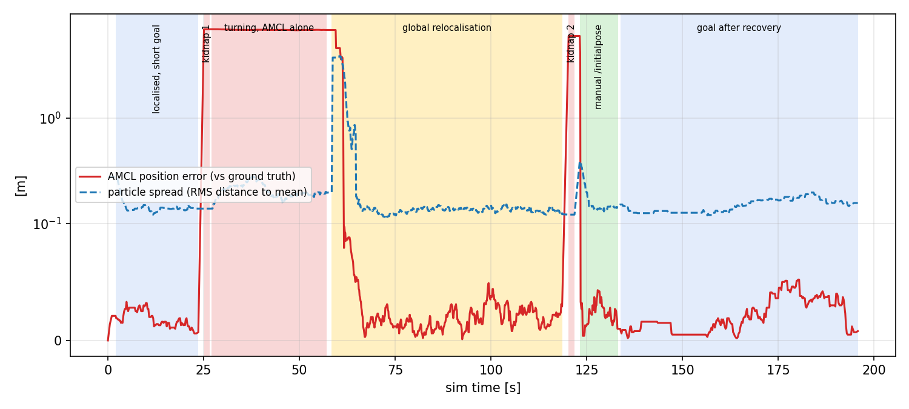

*Fig. 11: W3, AMCL position error (red) and particle spread (blue, dashed), log scale.*

| Step | AMCL error | Particle spread | Notes |
| --- | --- | --- | --- |
| Localised (after a short goal) | 0.7 cm | 0.14 m | |
| Kidnap 1: 6.95 m, 120° | 6.95 m | 0.14 m | AMCL is sure, and wrong |
| 30 s turning, AMCL alone | 6.83 m | 0.2 m | **no recovery**: with `recovery_alpha_*` = 0 AMCL never adds particles away from its current cloud, so it cannot find the robot again |
| Global relocalisation: particles spread over the whole map | – | 3.74 m | |
| … after 6.1 s of turning | < 0.25 m | < 0.25 m | **converged** |
| … after 60 s | 4 cm | 0.12 m | |
| Kidnap 2: 6.0 m | 5.99 m | 0.13 m | |
| Manual `/initialpose` at the true pose, 10 s turning | 1.0 cm | 0.14 m | |
| Goal (1.8, −1.3) after recovery | 0.8 cm | | SUCCEEDED in 60 s |

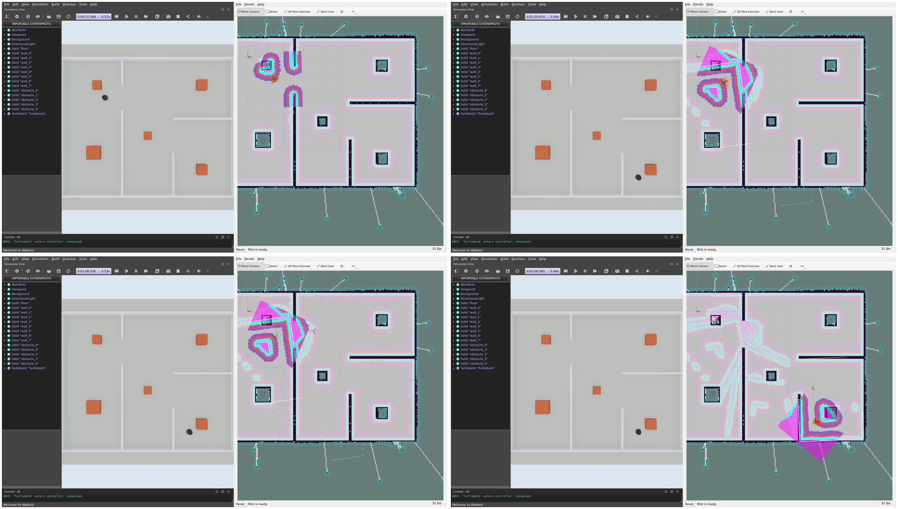

*Fig. 11b: W3 in RViz. Top left: localised before the kidnap. Top right: after the kidnap, the scan (white) lies across the map's walls while AMCL still shows the old pose. Bottom left: global relocalisation spreads the particles (red) over the whole map. Bottom right: converged.*

Takeaways:
- AMCL is a particle filter: it can represent "anywhere on the map" and converge from there.
  The room layout is asymmetric enough that 6 s of turning on the spot picked out the true
  pose among all the candidates.
- AMCL does **not** notice a kidnap by itself in our configuration. Its particles all stay near
  the old pose, and the likelihood-field model still finds a "best" particle among them.
  Recovery needs an external trigger (global relocalisation service, or a person setting
  the pose), or random-particle injection (7.2).

### 7.2 AMCL with random-particle injection (not run)

Setting `recovery_alpha_slow: 0.001` and `recovery_alpha_fast: 0.1` makes AMCL add random
particles when the short-term scan likelihood drops below the long-term average, which
should let it recover from a kidnap without help. `run_all.sh` has this test (W7,
`nav2_recovery.yaml`), but it was skipped for time and has no result.

### 7.3 Hector (W4, W5)

Hector tracks the pose by matching each scan against the map, starting the search from the
previous pose. It has no particle set, no global search and no loop closure. Both runs: W1's
patrol, kidnap about 55 s after the start.
Data: [`webots/W4_hector_kidnap_large/`](webots/W4_hector_kidnap_large/), [`webots/W5_hector_kidnap_small/`](webots/W5_hector_kidnap_small/).

| | W4: large kidnap | W5: small kidnap | W1: no kidnap |
| --- | --- | --- | --- |
| Jump | 2.05 m, 91° | 0.22 m, 10° | – |
| Error just after | 6.7 m (it keeps getting worse) | 0.24 m | – |
| Recovered? | **no**, error 6.0 m at the end | **yes**, < 6 cm at the next sample (1 s) | – |
| Wall precision | **25.1 %** | 99.1 % | 99.0 % |
| Wall recall | 51.4 % | 100.0 % | 100.0 % |
| Free coverage | 79.8 % | 97.6 % | 97.6 % |
| Mean wall error | 1.83 m | 2.5 cm | 2.5 cm |
| Position RMSE | 6.70 m | 3.6 cm | 3.3 cm |

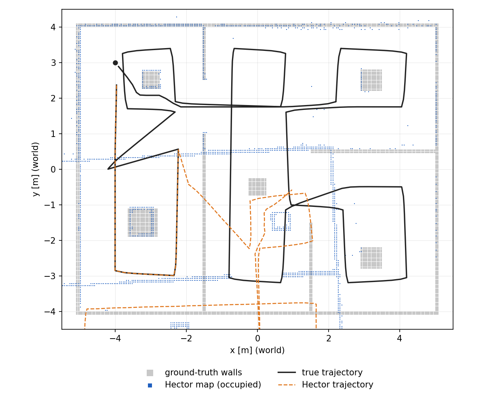

*Fig. 14: W4. After the kidnap Hector's trajectory (orange) no longer follows the true one (black), and the walls it maps from then on (blue) are drawn in the wrong place.*

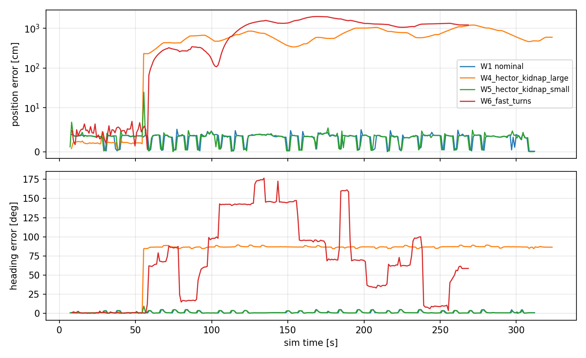

*Fig. 13: Hector's position and heading error for W1 (no kidnap), W4 (large kidnap), W5 (small kidnap) and W6 (fast turns).*

Why: the Gauss–Newton matcher only converges when the start pose is within roughly one
coarse-map cell (0.1 m at level 1) and a few degrees of the truth. 0.22 m / 10° is still in
that basin of convergence: the next scan pulls the pose back. 2 m / 91° is far outside it.
The matcher converges to the nearest local minimum, the robot is now "somewhere else" in a
map that doesn't match, and every map update writes the new walls in the wrong place. The
error then compounds, because the corrupted map makes the next matches worse too. This is the
main practical difference from a particle filter (AMCL, GMapping) or a graph SLAM with loop
closure (Cartographer, SLAM Toolbox): nothing in Hector can re-find the robot or repair the map.
In practice the fix is procedural: reset the map (`/syscommand reset`) or set the pose with
`/initialpose`, which Hector supports.

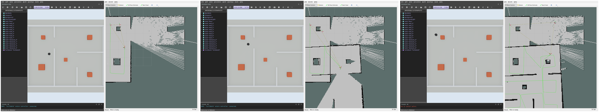

*Fig. 15: W4 in Webots and RViz: before the kidnap, 24 s after, and at the end of the patrol.*

## 8. Fast turns (W6)

W1's patrol at 3× speed: turns up to 1.8 rad/s (103°/s). That is about the turn rate seen
during the real robot's big slip (96°/s, section 9). Data: [`webots/W6_fast_turns/`](webots/W6_fast_turns/).

| Metric | W6, 3× speed | W1, 1× |
| --- | --- | --- |
| Max turn rate (true, 1 s average) | 82°/s (peaks 103°/s) | 34°/s |
| Tracking | first loss at t = 58 s: a 12° heading slip during a turn, then lost for good | held for the whole run |
| Wall precision | **17.8 %** | 99.0 % |
| Wall recall | 79.0 % | 100.0 % |
| Free coverage | 83.1 % | 97.6 % |
| Mean wall error | 5.06 m | 2.5 cm |
| Position RMSE | 11.2 m | 3.3 cm |

In Webots the scans are perfect (no noise, no motion blur, exactly 10 Hz). Even so, Hector
without odometry loses track at about 80–100°/s, i.e. 8–10° of rotation between scans. After
the first slip it fails the same way as after the kidnap (7.3): every later scan is matched
against a map that no longer fits. This reproduces the real robot's big slip (9.2) in
simulation and gives the practical speed limit for lidar-only Hector: keep turns well below
~1 rad/s at a 10 Hz lidar (Nav2 is capped at 0.6 rad/s in our config, and none of the Nav2 runs
lost track).

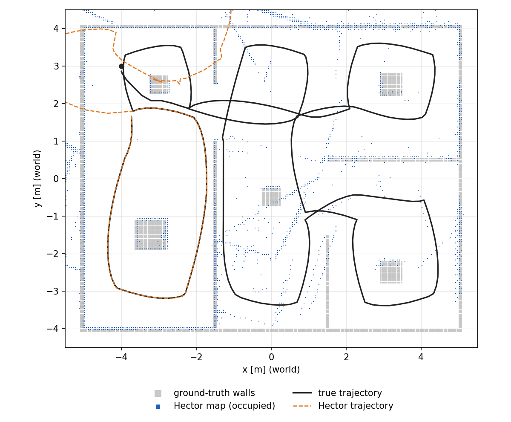

*Fig. 14c: W6, 3× patrol speed. The map breaks up after the first slip.*

## 9. Real TurtleBot 4

There is no ground truth on the robot, so the real-robot results are a map, the Hector pose,
and a comparison with the robot's own odometry. The Create 3 heading comes from its gyro and
drifts slowly. A sudden jump in Hector yaw minus odometry yaw therefore means Hector's scan
matching slipped.

### 9.1 Session

| | |
| --- | --- |
| Duration | 198 s rosbag; Hector running for ~160 s |
| Topics | `/scan` 1496 msgs (7.5 Hz), `/odom` 3453 (17.4 Hz), `/tf` 3466, `/tf_static` 2, `/map` 93 |
| Driving | by hand from the dashboard; path 14.2 m (odometry), 627° of total rotation, turn rate up to 96°/s (from the odometry stamps) |
| Hector rate | 8.1 Hz scans in, 8.1 Hz poses out (dashboard status): every scan processed |
| Clock | scans arrive 0.27 s after their stamp (dashboard check) |

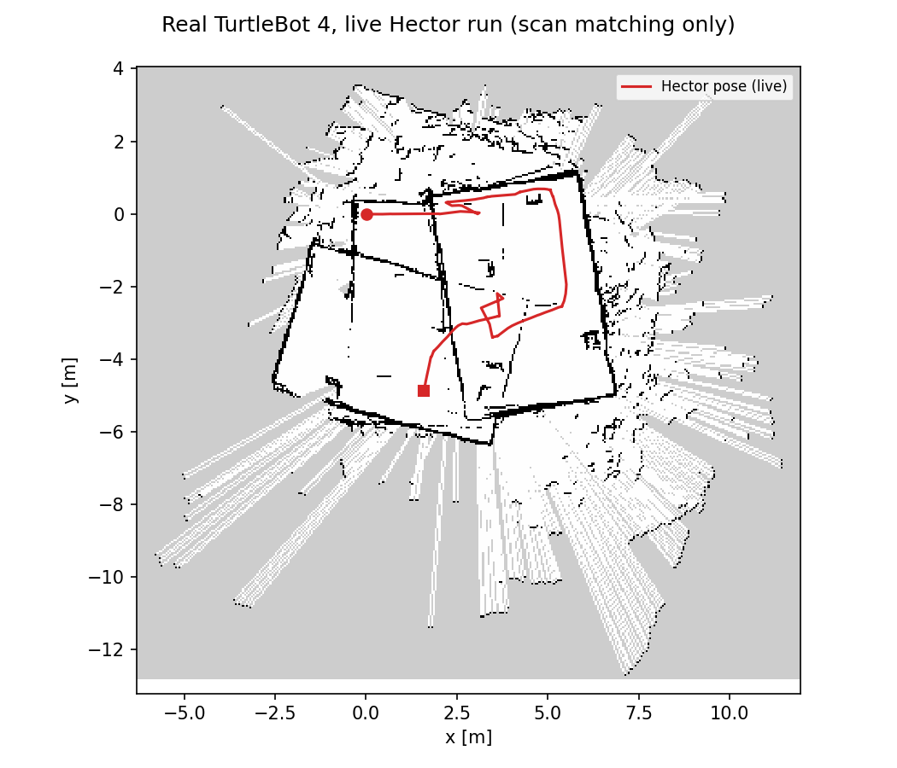

*Fig. 20: Real robot, the map Hector built live, with Hector's trajectory. The single room appears twice, rotated.*

### 9.2 What happened

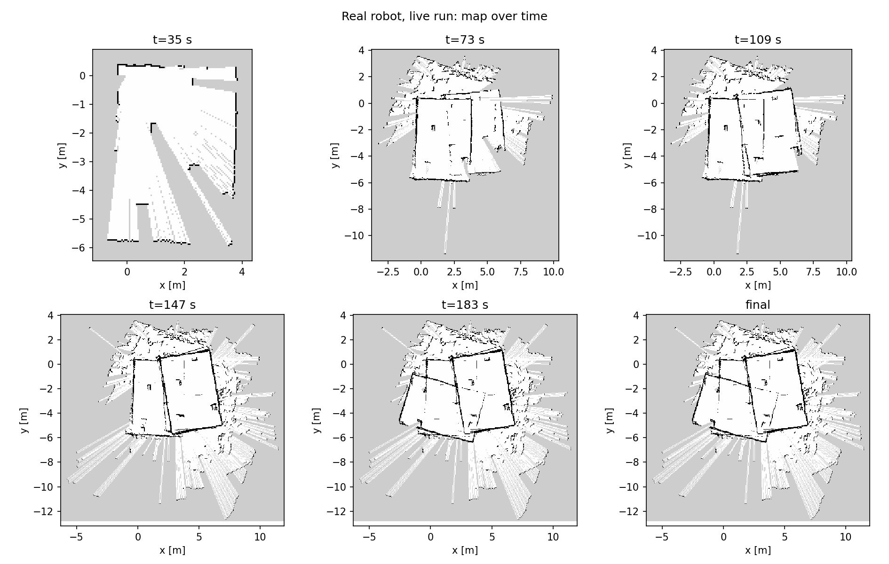

*Fig. 21: Real robot, live run: the map every ~37 s (from the `/map` messages in the bag).*

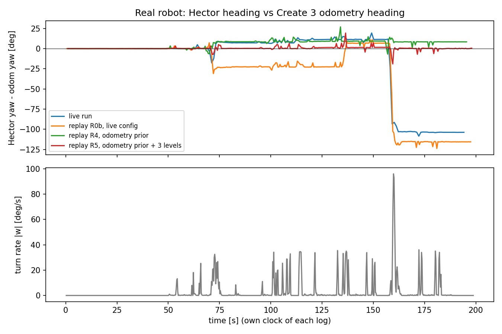

*Fig. 22: Top: Hector heading minus odometry heading, live run and the replays. Bottom: turn rate from odometry.*

- 0–70 s: a clean single room (fig. 21, t = 35 s). Measured from the map it is
  4.03 m × 6.08 m (strongest wall lines, `scripts/measure_room.py`).
- ~72 s: a slip of about −18°, then +10°, during a turn at only ~36°/s. Hector settles
  ~10° off. From then on the walls it adds are rotated by 10°. The cause is not clear from
  the data. It happens in every replay too (9.4), so it is in the scans, not a timing accident.
  A person or a door moving in view would explain it.
- ~158 s: a fast turn, 96°/s (1.7 rad/s, above the dashboard's 0.8 rad/s setting) for about a
  second, gives a **~110° slip**. At 7.5 Hz the robot turns ~13° between scans, which is about the
  edge of the matcher's convergence basin. The rest of the run is mapped rotated by ~110°:
  the second copy of the room in fig. 20.

The first real-robot test the day before (`pictures/`) showed the same kind of rotated
duplicate rooms. This failure is the same one as the Hector kidnap (7.3) and the fast-turn
test (8): Hector loses the pose when one scan-to-scan motion leaves the convergence basin.

### 9.3 Replaying the bag

The rosbag has everything Hector needs (`/scan`, `/odom`, `/tf` odom → base_link,
`/tf_static`). It does not have the live Hector's `map → odom`: the dashboard's recorder
subscribed to `/tf` as transient-local and dropped Hector's volatile `/tf` publisher. So the
bag can be replayed (`ros2 bag play --clock`, `scripts/replay_real.sh`) into a fresh Hector
with different parameters. Each replay used its own ROS domain.
Data: [`real_robot/replays/`](real_robot/replays/).

| Replay | Change | Final heading offset | Largest offset | Map |
| --- | --- | --- | --- | --- |
| live run | – | −104° | 109° | two rooms |
| R0 | none (same config as live) | −131° | 136° | two rooms |
| R0b | none, repeated | −116° | 124° | two rooms |
| R2 | 3 map resolution levels (coarser start) | −88° | 96° | two rooms |
| R1 | `use_tf_pose_start_estimate` as shipped in the port | – | – | worse: Hector at 2 Hz (see 9.4), four rooms |
| R4 | odometry prior (fixed) | **+8°** | 27° | one room + a 1.5 m ghost wall from the 72 s slip |
| **R5** | **odometry prior (fixed) + 3 levels** | **+0.5°** | 19° | **one clean room, 4.20 m × 6.19 m** |

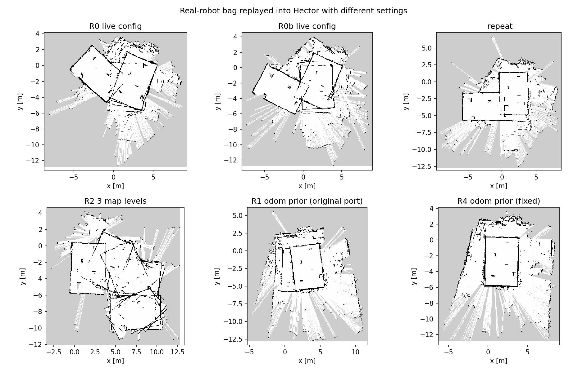

*Fig. 23: The same real-robot bag replayed into Hector with different settings.*

The replays of the unchanged config are not identical to each other (R0, R0b and the live
run end at −104° to −131°). The slip at 158 s is chaotic: where Hector ends up depends on
scan timing to within a few milliseconds. All three fail, though.

### 9.4 The fix: a wheel-odometry prior for the scan matcher

Hector normally starts each scan match from the previous scan's pose. It ignores odometry
completely, which is why it can be used on platforms without wheels. The option
`use_tf_pose_start_estimate` makes it start from the TF pose instead. In the ROS 2 port this
option was broken: it looked up `map → base_link` at the scan stamp, but `map → odom` is
Hector's own output, stamped one scan earlier. So every lookup waited 0.5 s for a transform
that never came and fell back to the old pose, and Hector ran at 2 Hz (replay R1: 387 poses
from 1450 scans). We changed it to use the previous pose plus the odometry motion since the previous scan
(`hector_mapping/src/HectorMappingRos.cpp`, documented in
`turtlebot_hector_slam/docs/hector_ros2_port_fixes.md`).

With the prior, Hector survives the 96°/s turn: the odometry predicts the 13° per scan, so
the matcher starts inside its basin. The extra coarse level (R5) widens the basin further and
also absorbs the 72 s slip. R5's room, 4.20 m × 6.19 m, agrees with the clean early part of the
live map (4.03–4.15 m × 6.08–6.11 m) to within 5–17 cm, about one to three map cells.

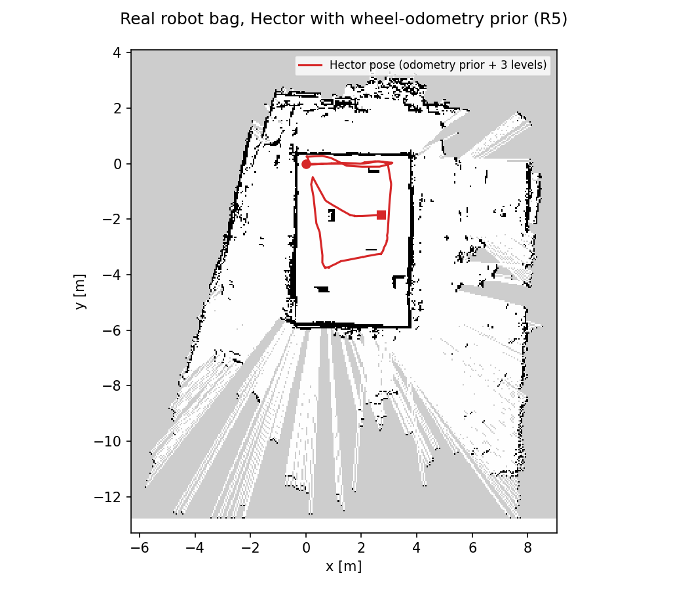

*Fig. 24: Real-robot bag, Hector with the wheel-odometry prior and 3 levels (R5).*

What this means for the robot: drive slowly (≤ 0.3 rad/s, as in the guide), or turn on the
odometry prior. Our default config keeps it off, so the Webots results above are pure
lidar-only Hector. The prior is the one change that made the real-robot data map correctly.
It is still unverified live on the robot.

**Not measured on the real robot:** absolute map accuracy (no tape measurements were taken),
localisation accuracy and Nav2 phase 2. Those need a new session: measure the room with a
tape, then run phase 2 and measure the stop positions against floor marks
(`turtlebot_hector_slam/docs/ASSIGNMENT_GUIDE.md` section 3).

## 10. Processing rate and architecture

| Run | `/scan` in | `/slam_out_pose` out | `/map` |
| --- | --- | --- | --- |
| Webots W1 | 8.93 Hz | 8.93 Hz | 0.5 Hz (`map_pub_period` 2 s) |
| Real robot (dashboard) | 8.1 Hz | 8.1 Hz | 0.5 Hz |
| Real-robot bag replay (R0, R4) | 7.3 Hz | 7.3 Hz | 0.5 Hz |
| Replay R1 (port's broken prior) | 7.3 Hz | **2.0 Hz** | 0.5 Hz |

Hector processes every scan in real time on a laptop CPU. A scan match on a 512 × 512 grid
with 2 levels takes a few milliseconds.

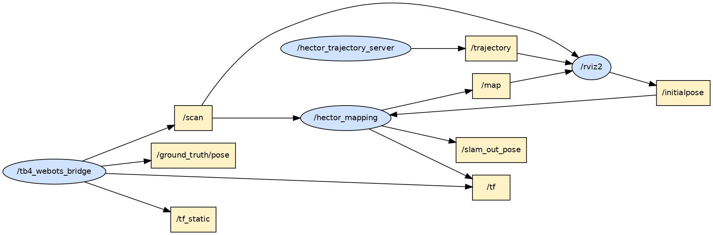

*Fig. 6: Phase 1 ROS graph (live, from the running system, rqt_graph style; loggers omitted). `/scan` → `hector_mapping` → `/map`, `/slam_out_pose`, `/tf` (map → odom); `hector_trajectory_server` → `/trajectory`.*

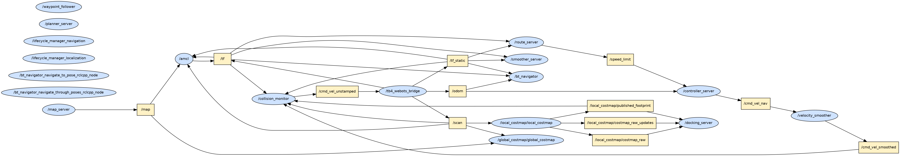

*Fig. 8: Phase 2 ROS graph: map_server, AMCL and the Nav2 servers.*

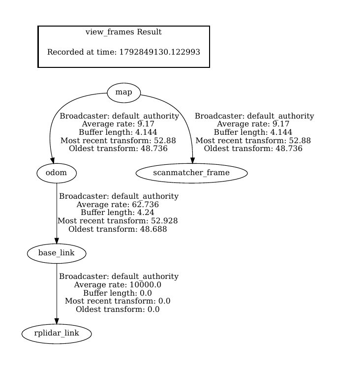

*Fig. 7: TF tree during phase 1 (`tf2_tools view_frames`): `map → odom` (Hector), `odom → base_link` (wheel odometry), `base_link → rplidar_link` (static).*

Node and topic lists: `webots/W1_mapping/ros_graph_phase1.txt`, `webots/W2_nav_goals/ros_graph_phase2.txt`.

## 11. Limitations and insights

| Finding | Evidence | Why |
| --- | --- | --- |
| Very accurate maps when tracking holds | 98–99 % precision, 2.5–3 cm wall error, 0.7 cm stopped pose error (4) | scan-to-map matching against a smooth (bilinearly interpolated) multi-resolution grid; every scan is matched against the whole map, not just the previous scan, so there is no scan-to-scan drift |
| No recovery from a large pose error | kidnap W4, real-robot slips (7.3, 9) | local Gauss–Newton search from the previous pose; no particles, no global search, no loop closure |
| Sensitive to fast rotation without odometry | W6, real robot 96°/s turn (8, 9) | the rotation between two scans must stay inside the matcher's convergence basin; at 7.5 Hz, 1.7 rad/s is ~13° per scan |
| A wheel-odometry prior fixes it | real-robot replay R5: 0.5° final heading error (9.4) | the prior moves the matcher's start pose to within a few degrees of the truth |
| AMCL relocalises, Hector doesn't | W3: global relocalisation in 6 s (7.1) | a particle filter can represent many hypotheses at once |
| AMCL as configured doesn't notice a kidnap | W3: 6.8 m error for 30 s, no recovery (7.1) | `recovery_alpha_*` = 0 (random-particle injection off) |
| Two phases are needed on the real robot | combined launch gave an empty map on the robot; Hector alone mapped | `ASSIGNMENT_GUIDE.md`; in phase 2 map_server + AMCL own `/map` and `map → odom` |
| Nav2 stalls next to walls | 3 of 8 explorer goals per run time out (6) | frontiers inside the inflation zone; DWB finds no valid trajectory |

## 12. Reproduce

All scripts are in [`scripts/`](scripts/). Webots runs need the `jazzy` container and
`~/ros2_jazzy_ws/src/turtlebot-hector-slam-jazzy` (the clone the container mounts).

```bash
S=~/ros2_jazzy_ws/src/turtlebot-hector-slam-jazzy/report_content/scripts
$S/run_w1_mapping.sh ~/ros2_jazzy_ws/work/webots/W1_mapping          # phase 1, patrol, screenshots, video, graphs
$S/run_all.sh 2                                                     # W2-W6 (uses W1's map; W7/W8 optional)
# real-robot bag (inside the container)
python3 $S/bag_tools.py strip real_robot/rosbag real_stripped
$S/replay_real.sh real_stripped out/R5 56 use_tf_pose_start_estimate:=true map_multi_res_levels:=3
$S/collect.sh                                                       # copy results here, build figures/
```

| Script | Does |
| --- | --- |
| `sim_lib.sh` | Webots + bridge + ROS on a private Xvfb display; screenshots (`import`), video (`ffmpeg x11grab`), window placement (`xwin.py`) |
| `run_w1_mapping.sh` | phase 1: Hector, patrol, optional kidnap (`--kidnap-at`) or speed (`--patrol-speed`), map save, `evaluate_map.py` |
| `run_w2_nav.sh` + `nav_tests.py` | phase 2: Nav2 + AMCL; goal test or kidnap test |
| `kidnap.py` | teleport the robot (absolute or relative) |
| `run_logger.py` | map/odom/ground-truth pose at 2 Hz, scan and SLAM rates, last `/map` |
| `ros_graph.py` | live ROS graph to graphviz (rqt_graph equivalent) |
| `bag_tools.py`, `replay_real.sh`, `analyze_real.py`, `measure_room.py` | real-robot bag: maps, odometry, replays, heading slips, room size |
| `plot_map.py`, `plot_errors.py`, `collect.sh` | figures |

## 13. Files

| Folder | Contents |
| --- | --- |
| `figures/` | report figures, numbered as above |
| `videos/` | short clips for the slides (section 14) |
| `webots/W*/` | per run: `map.pgm/.yaml`, `eval.txt/.png`, `pose.csv`, `trajectory.csv`, screenshots (`*.png`), full screen recording (`video.mp4`), launch and sim logs; W2/W3/W7 also `goals.*`, `kidnap.csv`, `kidnap_events.txt` |
| `real_robot/` | live map (`map.*`, `snap_*`), odometry from the bag, heading-slip analysis, `replays/R*/` (map, trajectory, parameters, logs) |

## 14. Videos

Short, sped-up clips for the slides are in [`videos/`](videos/). The full-length recordings
(10 fps, Webots left, RViz right) are `webots/W*/video.mp4`.

| Clip | Shows |
| --- | --- |
| `W1_mapping_timelapse_8x.mp4` | phase 1: Hector builds the map during the patrol |
| `W3_amcl_kidnap_and_recovery_6x.mp4` | phase 2, Nav2 + AMCL on the saved map: a goal, then the kidnap: lost, global relocalisation (particles everywhere), converged, manual pose |
| `W4_hector_kidnap_large_4x.mp4` | Hector large kidnap: the map gets drawn over in the wrong place |
| `W5_hector_kidnap_small_4x.mp4` | Hector small kidnap: recovers immediately |
| `W6_fast_turns_loses_track_4x.mp4` | 3× speed: Hector loses track on a fast turn |
| `real_robot_live_map_3x.mp4` | real robot, dashboard: the live map and the rotation slip |
